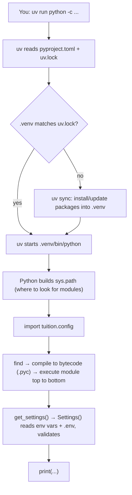

# Step 1c — How this project's code is found, compiled and run

If you come from Java, C# or C++, Python's model looks unusual: there is no separate build step,
no `main()` that the compiler requires, and no classpath you write by hand. This page traces
exactly what happens when we run:

```bash
uv run python -c "from tuition.config import get_settings; print(get_settings())"
```

## The big picture



## 1. Where does it start?

**Right now, nothing in the project runs on its own.** Step 1 is a *library*: `config.py`
defines things (a class, a function) but doesn't do anything when loaded. Something outside has
to import it and call it — today that's our one-liner.

Python has no required `main()`. Any file can be run, and it executes **top to bottom**.
Projects create *entry points* deliberately. Ours will be:

| Entry point | How it's started | Arrives in |
|---|---|---|
| CLI (`tuition mock generate`, `tuition billing run`…) | `[project.scripts] tuition = "tuition.cli:app"` in `pyproject.toml` → uv creates `.venv/bin/tuition` | Step 3 |
| Tests | `uv run pytest` discovers `tests/test_*.py` | Step 2 |
| API server | `uvicorn tuition.api:app` | Step 10 |
| MCP tool server | `python -m tuition.mcp` | Step 7 |

The `if __name__ == "__main__":` idiom you may have seen is how a single file says "do this only
when run directly, not when imported". We'll use the `[project.scripts]` approach instead,
which is cleaner for packages.

## 2. `uv run` — making sure the environment is right

1. uv finds `pyproject.toml` in the current folder (or a parent).
2. It compares `uv.lock` with what's installed in `.venv`. If anything differs, it syncs first.
3. It runs the command using **`.venv/bin/python`** — the project's own interpreter, not your
   Mac's system Python.

So `uv run X` = "run X inside this project's environment, after making sure it's up to date".

## 3. Is Python compiled?

Yes, but automatically and invisibly:

1. On first import, Python **compiles `config.py` to bytecode** — instructions for Python's
   virtual machine (like Java bytecode for the JVM).
2. It caches that in `src/tuition/__pycache__/config.cpython-312.pyc` (`312` = Python 3.12).
3. Next time, if `config.py` hasn't changed, it loads the `.pyc` directly and skips compiling.
4. The Python VM then **executes** the bytecode.

There's no separate "build" because this happens on every import. `__pycache__` is git-ignored.

## 4. How does `import` find modules? — `sys.path`

When Python sees `import something`, it searches a list of folders **in order** — `sys.path`.
See it yourself:

```bash
uv run python -c "import sys; print(*sys.path, sep='\n')"
```

Output (on macOS, roughly):

```
                                                  ← '' = current folder
/…/python3.12/lib/python312.zip                   ← standard library (zipped)
/…/python3.12/lib/python3.12                      ← standard library
/…/python3.12/lib/python3.12/lib-dynload          ← stdlib C extensions
/…/TutionFee/.venv/lib/python3.12/site-packages   ← third-party packages (pydantic…)
/…/TutionFee/src                                  ← OUR code
```

Each kind of import in `config.py` comes from a different entry:

| Import in `config.py` | Found in |
|---|---|
| `from decimal import Decimal`, `enum`, `functools`, `pathlib` | Standard library — ships with Python |
| `from pydantic_settings import BaseSettings` | `.venv/lib/python3.12/site-packages/pydantic_settings/` — installed by `uv sync` from `pyproject.toml` |
| `from tuition.config import …` (our one-liner) | `src/tuition/config.py` |

Check where each one actually comes from:

```bash
uv run python -c "import tuition, pydantic, decimal; print(tuition.__file__); print(pydantic.__file__); print(decimal.__file__)"
```

## 5. How does `src/` get onto `sys.path`? — the editable install

This is the least obvious part. `uv sync` doesn't only install pydantic — it also installs
**this project itself** in *editable* mode (because of `[build-system]` in `pyproject.toml`).
Editable install doesn't copy our code; it drops a one-line file into site-packages:

```bash
cat .venv/lib/python3.*/site-packages/_editable_impl_tuition_fee_agents.pth
# → /Users/…/TutionFee/src
```

At startup, Python reads every `.pth` file in site-packages and adds each path in it to
`sys.path`. That's how `/…/TutionFee/src` got there.

Consequences:
* `import tuition` works from **any** folder, in tests, the CLI, and the API — no path hacks.
* Edits to files under `src/` take effect immediately (no reinstall), because Python reads them
  from where they are.
* `[tool.hatch.build.targets.wheel] packages = ["src/tuition"]` is what tells the build backend
  (hatchling) that `src/` is where the code lives.

## 6. Packages and modules — how names map to files

| Python name | File |
|---|---|
| `tuition` (package) | `src/tuition/__init__.py` |
| `tuition.config` (module) | `src/tuition/config.py` |
| `tuition.db.models` (Step 2) | `src/tuition/db/models.py` |

A **module** is one `.py` file. A **package** is a folder with an `__init__.py`. Dots in the
import mirror folders on disk.

## 7. What happens on `from tuition.config import get_settings`

1. **Check the cache:** is `tuition.config` already in `sys.modules` (the loaded-modules dict)?
   If yes, reuse it — **every module runs at most once per process**.
2. **Import the parent package first:** find `tuition` on `sys.path` → run
   `src/tuition/__init__.py` (sets `__version__`).
3. **Find and compile `config.py`** (or load its cached `.pyc`).
4. **Execute it top to bottom:**
   * lines 5–10: the imports (each goes through this same process)
   * line 13: build the `BillingPolicy` enum class
   * line 20: build the `Settings` class — pydantic inspects the type hints **here, at class
     creation**, and prepares validators for each field. Nothing is read from `.env` yet.
   * line 34: define `get_settings` and wrap it with `lru_cache`.
5. **Bind the name:** put `get_settings` into the caller's namespace.

## 8. What happens on `get_settings()`

1. `lru_cache` checks: called before? Return the same object. (First time: no.)
2. `Settings()` runs. For each field, pydantic-settings looks for a value in this order:
   1. real environment variables (`export BILLING_DUE_DAY=7`)
   2. the `.env` file (because of `env_file=".env"`)
   3. the default in the class
3. Each value is validated and converted to its type (`"5"` → `5`, `"1.00"` → `Decimal("1.00")`).
   Any failure raises a `ValidationError` naming the field.
4. The object is cached and returned; `print` shows it.

> `.env` is found relative to the **current working directory**. Run commands from the project
> root (VS Code's terminal does by default).

## Try it

```bash
# where Python looks for modules
uv run python -c "import sys; print(*sys.path, sep='\n')"

# where each import really comes from
uv run python -c "import tuition, pydantic; print(tuition.__file__); print(pydantic.__file__)"

# the .pth file that puts src/ on the path
cat .venv/lib/python3.*/site-packages/_editable_impl_tuition_fee_agents.pth

# the bytecode cache appears after the first import
ls src/tuition/__pycache__

# every module Python imports, with timing (stderr, so 2>&1)
uv run python -X importtime -c "import tuition.config" 2>&1 | tail -15

# environment variables beat .env — try it
BILLING_DUE_DAY=9 uv run python -c "from tuition.config import get_settings; print(get_settings().billing_due_day)"
```

In VS Code: set a breakpoint on line 36 (`return Settings()`), run the one-liner with the debugger,
and **Step Into** (F11) to walk through pydantic-settings reading `.env`.
